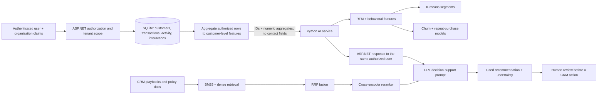

# AI Customer Intelligence Lab

An AI R&D prototype for turning relational CRM data into customer segments, predictive scores and source-grounded next-action briefings. The main research feature is a hybrid RAG pipeline: BM25 keyword search + dense embeddings → reciprocal-rank fusion → cross-encoder reranking → LLM response with source IDs.

The ASP.NET Core API is the CRM-facing adapter. Python owns the machine-learning and RAG workflows. A Streamlit app makes the research visible and lets a CRM owner inspect evidence before acting.

**Implementation status:** the CRM API now has Identity authentication, organization-scoped SQLite persistence, customer CRUD, validated CSV import, lead management and conversion, customer transactions/interactions/notes/follow-ups, audit events, tenant-scoped K-Means segmentation, and a research benchmark comparing K-Means, hierarchical clustering, and DBSCAN. The Python AI service receives only minimized feature rows for the authenticated organization. Churn and repeat-purchase probabilities are intentionally marked unavailable until historical feature snapshots and future labels can be aligned and evaluated. Excel import and the authenticated CRM frontend remain future milestones. The standalone Streamlit research lab still uses clearly labeled synthetic demo data.

> The included customer data and future labels are generated for demonstration. They contain no names, emails, phone numbers or payment details. Do not treat sample model metrics as business results.

## Architecture



### Why the project is structured this way

1. **Feature layer:** transactions and interactions are aggregated to one row per customer before joining. That avoids duplicated customer rows and makes the time window explicit.
2. **Predictive layer:** K-means discovers groups; separate classifiers estimate the next-30-day churn and purchase outcomes. Holdout metrics are reported separately from scores.
3. **Retrieval layer:** BM25 catches exact terminology, dense embeddings catch paraphrases, reciprocal-rank fusion combines candidate lists, and a CrossEncoder reorders a smaller shortlist.
4. **Generation layer:** the LLM receives only the selected customer features and retrieved excerpts. It must return source IDs; the service drops citations that were not retrieved and exposes a citation audit.
5. **Decision layer:** the API and dashboard surface a review queue. Sending an offer or contacting a customer stays with a human.

## Project map

| Path | Purpose |
|---|---|
| `AI_Customer_Intelligence.slnx` | Open this solution in Visual Studio 2026 |
| `src/Crm.Api/Controllers/` | CRM endpoints for customers, leads, activity history, insights and the assistant |
| `src/Crm.Api/Data/` | EF Core database context and tenant-scoped migrations |
| `src/Crm.Api/Models/` | Organization, user, customer, transaction and activity entities/DTOs |
| `src/Crm.Api/Services/` | Tenant context, audit events, feature aggregation and Python AI-service client |
| `ai_crm/` | Feature engineering, models, retrieval and LLM orchestration |
| `knowledge_base/` | Small CRM playbooks indexed by the RAG pipeline |
| `research/` | Retrieval and answer evaluation sets and methodology |
| `research/architecture_walkthrough.md` | Layer-by-layer guide to trace one CRM question |
| `scripts/` | Synthetic-data generation and evaluation commands |
| `app.py` | Streamlit customer intelligence and RAG research UI |
| `ml_api.py` | FastAPI scoring and RAG service |
| `sql/schema.sql` | SQL Server schema reference for the relational grain |
| `tests/Crm.Api.Tests/` | API integration tests for registration, role scope, CRUD and tenant isolation |
| `tests/python/` | Python unit tests for the tenant segmentation pipeline |

## Run locally on Windows

### 1. Generate optional research demo data

From the project root:

```powershell
python scripts/generate_demo_data.py
```

This creates 1,500 synthetic customers plus separate transaction, interaction, activity and future-outcome tables in `data/demo/`. The files power the standalone research lab and do not populate the authenticated CRM database.

### 2. Create the Python environment

```powershell
python -m venv .venv
.\.venv\Scripts\Activate.ps1
python -m pip install --upgrade pip
pip install -r requirements.txt
Copy-Item .env.example .env
```

The first RAG request downloads the local embedding model. If enabled, it also downloads the local CrossEncoder reranker. The model weights stay in the machine's Hugging Face cache, outside this repository.

### 3. Choose LLM generation

The sample app works without an API key: `LLM_PROVIDER=auto` uses an evidence-and-score fallback when no model provider is configured. For generated prose, configure one of the following in `.env`:

- **OpenAI Responses API:** set `LLM_PROVIDER=openai`, `OPENAI_API_KEY`, and optionally `OPENAI_MODEL`. The starter model is `gpt-6.1-terra`; change it to a model enabled for your account.
- **Local OpenAI-compatible server:** set `LLM_PROVIDER=ollama`, `OLLAMA_BASE_URL`, and `OLLAMA_MODEL` to the model tag you have installed locally.
- **No LLM call:** set `LLM_PROVIDER=extractive`.

Never commit `.env`. Only synthetic data is supplied. Before sending real CRM fields to a hosted model, confirm the data-processing rules and minimize prompt fields.

### 4. Start the Python AI service

In terminal 1:

```powershell
uvicorn ml_api:app --reload --port 8000
```

FastAPI docs are available at `http://127.0.0.1:8000/docs` while the service is running.

### 5. Start the dashboard

In terminal 2:

```powershell
streamlit run app.py
```

The dashboard has an overview, a scored customer book with a CSV review queue, a cited RAG assistant, a retrieval research lab and an architecture/data-quality view.

### 6. Open and start the CRM API in Visual Studio

Open `AI_Customer_Intelligence.slnx` from this folder in Visual Studio. The CRM-facing ASP.NET Core adapter targets .NET 10 LTS. Then run `Crm.Api` with terminal 3:

```powershell
dotnet run --project src/Crm.Api
```

The ASP.NET API expects the Python service at `http://127.0.0.1:8000/`. Change `PythonService:BaseUrl` in `src/Crm.Api/appsettings.json` if the service runs elsewhere. On its first start, EF Core applies the checked-in migrations to `src/Crm.Api/App_Data/ai-crm.db` and seeds the Admin, Manager, and Sales Executive roles. The local database and protected cookie keys are ignored by Git.

Create the first organization and Admin account with `POST /api/auth/register`:

```json
{
  "organizationName": "Example CRM",
  "displayName": "CRM Administrator",
  "email": "admin@example.com",
  "password": "Use-A-Long-Unique-Password!"
}
```

Registration signs the new user in with an HTTP-only session cookie. For browser/API clients, first call `GET /api/auth/csrf`, then send the returned token in the `X-CSRF-TOKEN` header for POST, PUT, PATCH, and DELETE requests. Password reset tokens are sent through configured SMTP in non-development environments; local development writes the one-time token to the API log.

The current Streamlit app is a separate synthetic-data research demo. It is not yet the CRM frontend and does not share the ASP.NET login session.

## API routes

| Method | Route | Purpose |
|---|---|---|
| `GET` | `/health` | ASP.NET API health |
| `POST` | `/api/auth/register` | Create an organization and its first Admin account |
| `POST` | `/api/auth/login` | Start a cookie session |
| `POST` | `/api/auth/logout` | End the current cookie session |
| `GET` | `/api/auth/me` | Current user and organization |
| `GET` | `/api/auth/csrf` | CSRF token for authenticated write requests |
| `GET` | `/api/customers` | Tenant-scoped search, sort and paginated customer list |
| `POST` | `/api/customers` | Create a tenant-scoped customer |
| `POST` | `/api/customers/import` | Validate and import up to 10,000 CSV rows (10 MB max); reports duplicates and row errors |
| `GET` | `/api/customers/{customerId}` | Customer profile with transaction, interaction, note and follow-up history |
| `PUT` | `/api/customers/{customerId}` | Update a customer |
| `DELETE` | `/api/customers/{customerId}` | Archive a customer (Admin/Manager only) |
| `GET`, `POST` | `/api/customers/{customerId}/transactions` | List or add transaction history |
| `GET`, `POST` | `/api/customers/{customerId}/interactions` | List or record a customer interaction |
| `GET`, `POST` | `/api/customers/{customerId}/follow-ups` | List or schedule follow-ups |
| `PATCH` | `/api/customers/{customerId}/follow-ups/{followUpId}/complete` | Complete a follow-up |
| `POST` | `/api/customers/{customerId}/notes` | Add a customer note |
| `GET`, `POST` | `/api/leads` | Search/list leads or create a lead |
| `GET`, `PUT` | `/api/leads/{leadId}` | Read or update a lead |
| `PATCH` | `/api/leads/{leadId}/status` | Update a lead status |
| `POST` | `/api/leads/{leadId}/convert` | Convert a lead into a customer once |
| `GET` | `/api/insights` | Real tenant data counts and model availability/label status |
| `GET` | `/api/insights/segmentation?clusters=4` | Run K-Means on actual customer records; synthetic rows are excluded by default |
| `GET` | `/api/insights/segmentation/research?clusters=4` | Compare K-Means, Ward hierarchical clustering, and DBSCAN on the same authorized cohort |
| `GET` | `/api/insights/follow-ups?daysAhead=7` | Actual open follow-up records due now or in the requested window |
| `POST` | `/api/assistant/recommendations` | RAG response using the authorized customer’s minimized CRM aggregates |
| `GET` | `/api/users` | Organization users (Admin only) |
| `POST` | `/api/users` | Create a Manager or Sales Executive (Admin only) |

Customer CSV imports use a header row with `name` or `customer_name`. Optional headers are `email`, `phone`, `signup_date` (`yyyy-MM-dd`), `city`, `acquisition_channel`, `status`, and `external_id`. Invalid rows and duplicates are skipped with row-level reasons; valid rows are committed together. Excel workbooks are not accepted yet. Lead conversion is transactional and prevents converting the same lead twice. Sales Executives see only records they own, including activity and follow-up endpoints.

Example assistant request:

```json
{
  "customerId": "e1d34df8-8b20-4cb4-b92d-5f8c5cb3f3fc",
  "question": "What should the CRM owner review before choosing a next action?"
}
```

Python service routes include the standalone synthetic-data demo routes `GET /customers` and `GET /metrics`, the CRM API routes `POST /segmentation` and `POST /segmentation/research`, and the tenant-context RAG route `POST /assistant/tenant-recommendations`. The ASP.NET API authorizes and aggregates records before calling these tenant-context endpoints. It never asks Python to look up a customer by an unscoped identifier.

## AI research plan

**Research question:** Does hybrid retrieval plus a second-stage reranker retrieve more relevant CRM playbook evidence than BM25 or dense search alone?

**Baselines:** BM25, dense semantic retrieval, BM25+dense with RRF, and RRF followed by a CrossEncoder.

**Metrics:** Recall@5 (whether useful evidence reaches the model), MRR@5 (rank of the first relevant source), and NDCG@5 (ranking quality across relevant sources). The curated query set is in `research/retrieval_eval.jsonl`.

For tenant segmentation, `GET /api/insights/segmentation/research` fits K-Means, Ward hierarchical clustering and DBSCAN to one authorized tenant cohort using the same transformed feature matrix. The research comparison is capped at 5,000 customers because hierarchical clustering has quadratic memory/time behavior. The response includes per-customer memberships, mean-feature profiles, a shared PCA projection, K-Means elbow values, silhouette scores, DBSCAN noise counts, fit latency and reproducibility parameters. Silhouette excludes DBSCAN noise and is `null` when it cannot be measured. These are descriptive cluster diagnostics, not predictive performance or evidence that a segment label is a ground-truth customer category. Tune `dbscanEps` and `dbscanMinSamples` on a development cohort and document those settings before comparing runs.

Run the retrieval benchmark:

```powershell
python scripts/evaluate_retrieval.py
```

It writes per-query results to `research/retrieval_benchmark_results.csv`. Compare the methods on the same query set; do not tune a fusion weight on the final evaluation queries.

For answer quality, `research/methodology.md` includes a human review rubric for factual support, citation correctness, usefulness, uncertainty and safe action language. Retrieval metrics alone do not establish answer quality.

Run the small RAG answer study with the configured provider:

```powershell
python scripts/evaluate_rag.py
```

This records response latency, retrieved-source recall and citation-ID validity. It does not automatically claim that a valid citation supports a claim; use the human rubric for that review.

Run the CRM API integration tests and Python segmentation tests with:

```powershell
dotnet test tests/Crm.Api.Tests/Crm.Api.Tests.csproj
python -m unittest discover -s tests/python -v
```

## Current technical choices

- New OpenAI integrations use the Responses API; the model name is configurable because availability depends on account access. See the [OpenAI API overview](https://platform.openai.com/overview).
- The OpenAI path requests schema-constrained JSON using [Structured Outputs](https://developers.openai.com/api/docs/guides/structured-outputs).
- Hybrid retrieval and rank fusion follow the retrieval pattern described in the [Qdrant hybrid search documentation](https://qdrant.tech/documentation/search/hybrid-queries/).
- The second-stage reranker uses the `CrossEncoder` interface documented by [Sentence Transformers](https://www.sbert.net/docs/package_reference/cross_encoder/model.html).

## Limits and next research steps

- Synthetic labels are generated from observable feature patterns. This can make the learning problem easier than real churn and conversion work.
- The standalone demo classifiers use synthetic labels and a stratified random holdout. Replace it with time-based validation on historical snapshots before drawing conclusions. The authenticated CRM API does not expose those demo scores as real customer risk.
- Logistic regression scores are ranking aids; calibrate probabilities and select operating thresholds against real campaign costs.
- Segment labels are derived from cluster profiles for readability. Review each cluster's feature distributions before using the label.
- Add production connectors only after a data contract, consent model, access control and retention policy are defined.
- Next experiments: temporal validation, calibration curves, drift monitoring, prompt/version ablations, retrieval-latency/cost measurements and a blinded human review of generated recommendations.

